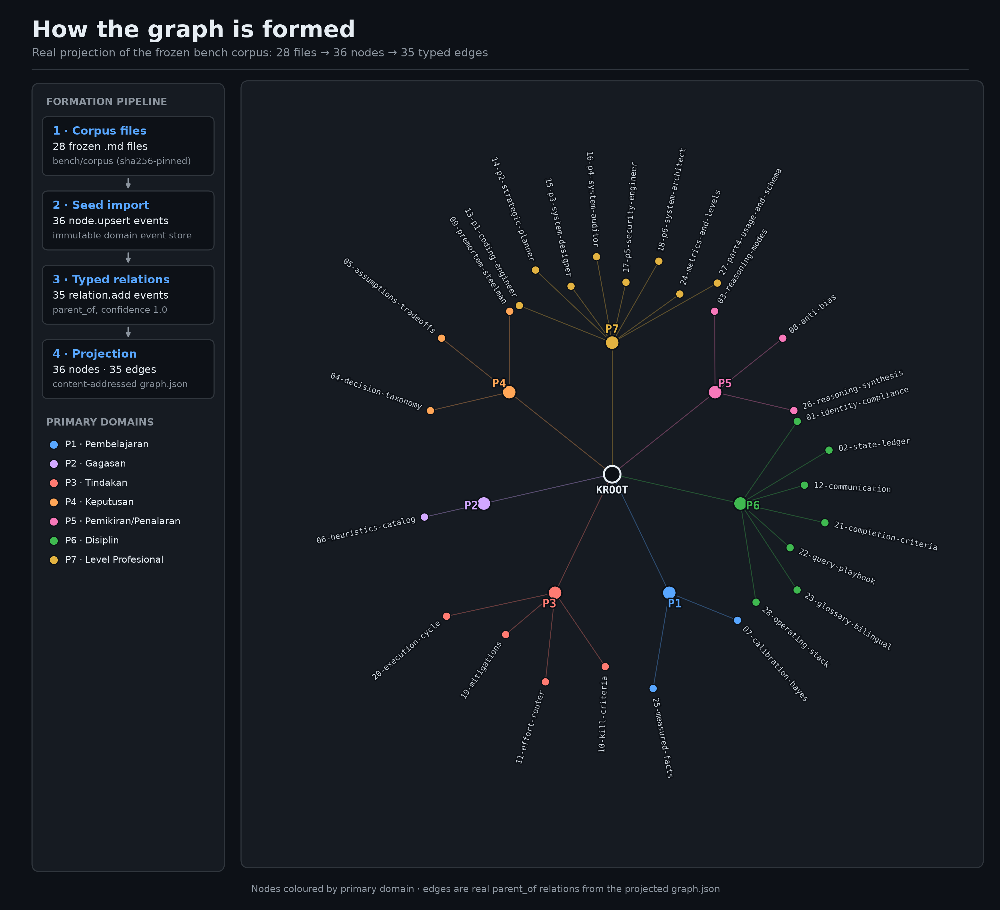
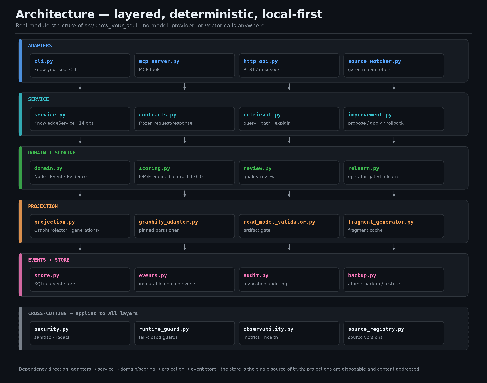
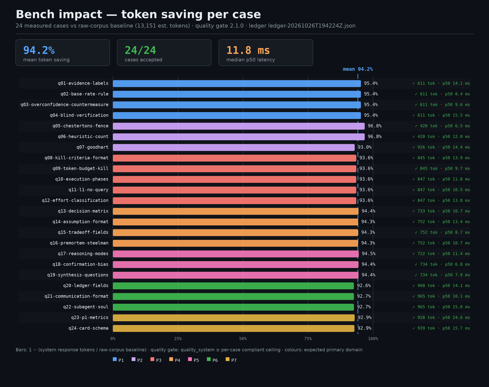
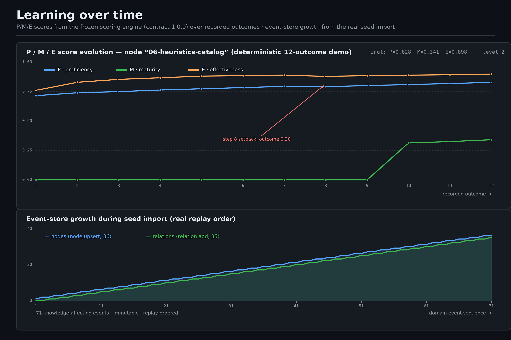

<div align="center">

[🇬🇧 English](README.md) | **🇮🇩 Bahasa Indonesia**

</div>

# Know Your Soul

<p align="center">
  <a href="https://github.com/Sigit-AP/know-your-soul/actions/workflows/ci.yml"></a>
  <a href="https://pypi.org/project/know-your-soul/"></a>
  
  
  <a href="LICENSE"></a>
</p>

**Know Your Soul** adalah graf pengetahuan dan pembelajaran yang mandiri dan
deterministik untuk [Hermes Agent](https://hermes-agent.nousresearch.com/docs).
Ia menyimpan apa yang telah dipelajari agen sebagai graf bersumber peristiwa
(*event-sourced*) yang dapat diaudit, menilai setiap node dengan aritmetika
Decimal yang eksak, dan hanya memperbaiki dirinya melalui proposal yang
disetujui operator. **Tidak ada model AI internal, API model, embedding,
pemanggilan vektor, dependensi provider, maupun lalu lintas keluar ke
provider** di mana pun dalam sistem ini — model tetap berada di sisi Hermes;
layanan ini adalah memori yang bisa dipercaya.

<p align="center">
  
</p>
<p align="center">
  <em>Bagaimana sebuah korpus menjadi graf: proyeksi nyata dari korpus benchmark
  yang dibekukan (36 node, 35 edge bertipe, diwarnai menurut domain primer).
  Dibangkitkan dari data proyek yang sebenarnya — lihat
  <a href="docs/assets/README.md">docs/assets</a>.</em>
</p>

## Daftar isi

- [Mengapa Know Your Soul](#mengapa-know-your-soul)
- [Fitur utama](#fitur-utama)
- [Mulai cepat](#mulai-cepat)
  - [Instalasi](#instalasi)
  - [CLI](#cli)
  - [API HTTP lokal](#api-http-lokal)
  - [Server MCP (Hermes)](#server-mcp-hermes)
- [Arsitektur](#arsitektur)
- [Hasil benchmark](#hasil-benchmark)
- [Siklus pembelajaran](#siklus-pembelajaran)
- [Empat belas operasi](#empat-belas-operasi)
- [Keamanan dan batas tanpa-AI](#keamanan-dan-batas-tanpa-ai)
- [Kontrak dan relearn yang dikendalikan operator](#kontrak-dan-relearn-yang-dikendalikan-operator)
- [Pengembangan](#pengembangan)
- [Peta jalan](#peta-jalan)
- [Kontribusi](#kontribusi)
- [Lisensi dan atribusi](#lisensi-dan-atribusi)

## Mengapa Know Your Soul

Agen membaca ulang dokumen yang sama di setiap sesi dan mempelajari ulang
pelajaran yang sama dengan cara yang mahal. Know Your Soul memberi agen satu
memori lokal yang deterministik:

- **Bertanya, bukan membaca ulang.** Retrieval berbatas token mengembalikan
  tepat `best_actions`, `recommendations`, `unnecessary_actions` — tidak pernah
  berupa curahan mentah isi korpus. Rata-rata penghematan token terukur
  dibanding membaca korpus mentah: **~94,2%** (24/24 kasus benchmark beku
  diterima).
- **Setiap jawaban dapat diaudit.** Setiap operasi — termasuk baca —
  mengembalikan ID peristiwa audit ke dalam event store SQLite append-only
  yang dirantai-hash.
- **Pembelajaran dinilai, bukan kira-kira.** Setiap node membawa skor P/M/E
  terkalibrasi yang dihitung dengan aritmetika Decimal eksak di bawah kontrak
  yang dibekukan.
- **Tidak ada yang memperbaiki diri tanpa Anda.** Perbaikan berupa proposal
  diff terstruktur; penerapan, pembelajaran ulang, dan rollback adalah mesin
  status yang dikendalikan operator, dengan rollback yang byte-exact.

## Fitur utama

| Kemampuan | Yang Anda dapatkan |
|---|---|
| **14 operasi teraudit** | Retrieval, evidence, penilaian, review, perbaikan, dan kata kerja graf — identik di CLI, HTTP, dan MCP |
| **Kebenaran bersumber peristiwa** | Event store SQLite WAL append-only; setiap mutasi berversi, idempoten, dan dirantai-hash |
| **Proyeksi content-addressed** | Generasi model-baca Graphify yang atomik, divalidasi dan diaktifkan lewat satu manifes `CURRENT` |
| **Penilaian deterministik** | Kontrak matematika beku; aritmetika Decimal eksak; formula tak boleh berubah tanpa versi kontrak baru |
| **Relearn berizin operator** | Perubahan korpus memicu `RelearnOffer` deterministik — sistem tak pernah memilih mode relearn sendiri |
| **Rollback byte-exact** | Setiap apply mengambil backup atomik terverifikasi; rollback memulihkan hash dan skor pra-apply secara persis |
| **Batas tanpa-AI yang keras** | Titik masuk provider/vektor/model gagal-tertutup; soket keluar ditolak; MCP hanya tools+resources |
| **Tiga jalur akses** | CLI (`know-your-soul`), API lokal persisten (Unix socket / HTTP loopback), server MCP (stdio / HTTP) |

## Mulai cepat

### Instalasi

Dari PyPI (memerlukan Python 3.14):

```bash
pip install know-your-soul
```

Atau dari sumber dengan environment terkunci yang bit-exact:

```bash
git clone https://github.com/Sigit-AP/know-your-soul.git
cd know-your-soul
uv sync --frozen
```

### CLI

Setiap perintah di bawah ini dijalankan terhadap store baru dan berstatus
keluar 0:

```bash
# Catat pengetahuan (upsert node yang teraudit dan idempoten)
know-your-soul --store demo.sqlite3 --output-root graph log-event \
  '{"node_id":"p1-root","kind":"primary","domain":"P1",
    "summary":"P1 root: verification discipline",
    "provenance":["soul://demo"],"source_version_id":"demo-v1"}'

know-your-soul --store demo.sqlite3 --output-root graph log-event \
  '{"node_id":"n1","parent_id":"p1-root","domain":"P1",
    "summary":"Always verify before claiming done",
    "provenance":["soul://demo"],"source_version_id":"demo-v1"}'

# Bangun ulang proyeksi content-addressed
know-your-soul --store demo.sqlite3 --output-root graph rebuild
```

```json
{"activated":true,"content_hash":"9728d2…","node_count":1,
 "projection_version":"gen-9728d2000ab6f02b0afc104b", "...":"..."}
```

```bash
# Retrieval berbatas token dengan provenance, versi, dan rekomendasi
know-your-soul --store demo.sqlite3 --output-root graph query \
  '{"purpose":"verify before claiming done","token_budget":400}'
```

```json
{"routing":"ranked","results":[{"node_id":"n1","kind":"leaf",
  "summary":"Always verify before claiming done","...":"..."}],
 "recommendations":{"best_actions":[],"recommendations":["..."],
  "unnecessary_actions":[]},
 "audit_event_id":"706813cd1ed848df8394a0fb0c5693b3","...":"..."}
```

```bash
# Periksa satu node beserta evidence dan metadata proyeksi
know-your-soul --store demo.sqlite3 --output-root graph get-node '{"node_id":"n1"}'

# Liveness: rantai hash, migrasi, watermark proyeksi — satu vonis JSON
know-your-soul --store demo.sqlite3 health
```

### API HTTP lokal

API lokal persisten menyajikan JSON berversi `/v1` melalui Unix socket secara
bawaan (HTTP loopback opsional; API key wajib di luar loopback):

```bash
know-your-soul --store demo.sqlite3 --output-root graph serve --socket demo.sock

curl -s --unix-socket demo.sock -X POST http://localhost/v1/ops/health \
  -H 'content-type: application/json' -d '{}'

curl -s --unix-socket demo.sock -X POST http://localhost/v1/knowledge/query \
  -H 'content-type: application/json' \
  -d '{"purpose":"verify before claiming done","token_budget":400}'
```

### Server MCP (Hermes)

Hubungkan Hermes dengan perintah MCP miliknya sendiri — tanpa menyunting
berkas konfigurasi secara manual:

```bash
hermes mcp add know-your-soul \
  --command /root/know-your-soul/.venv/bin/python \
  --args -m know_your_soul.mcp_server \
         --graph-root /root/know-your-soul/.local/graph \
         --db /root/know-your-soul/.local/know-your-soul.sqlite3

hermes mcp test know-your-soul
hermes mcp list
```

Hermes mendaftarkan empat belas operasi sebagai tool kelas-satu
(`mcp__know-your-soul__knowledge_query`, `…__knowledge_get_node`, …) dan
memanggilnya secara native. Server menolak menyala bila kredensial provider
ada di environment-nya. Panduan lengkap:
[docs/integration/hermes.md](docs/integration/hermes.md).

## Arsitektur

Monolit modular Python 3.14 — tiga jalur akses di atas satu layanan:

<p align="center">
  
</p>

- **Sumber kebenaran:** event store SQLite WAL append-only; setiap mutasi
  berversi dan idempoten; setiap invokasi (termasuk baca) tercatat sebagai
  tepat satu peristiwa audit akhir.
- **Model baca:** generasi Graphify content-addressed, divalidasi dan
  diaktifkan secara atomik lewat satu manifes `CURRENT`; perbaikan membangun
  ulang artefak yang robek atau korup hingga identik per-byte.
- **Determinisme:** kontrak matematika beku ([`docs/mathematics/`](docs/mathematics/),
  [`docs/contracts/`](docs/contracts/)); penilaian memakai aritmetika Decimal
  eksak; formula maupun ambang tak boleh berubah tanpa versi kontrak baru.

## Hasil benchmark

`bench/` adalah harness yang sepenuhnya deterministik: snapshot korpus berpin
sha256 (28 berkas, 52.604 byte = 13.151 token estimasi), 24 pertanyaan beku
yang mencakup ketujuh domain primer, kontrak estimator-token beku, dan gerbang
kualitas berbasis cakupan kata kunci — **tidak ada model yang terlibat di mana
pun**. Penghematan token tak pernah memaafkan regresi kualitas: sebuah kasus
hanya diterima bila melampaui langit-langit kualitas yang patuh kontrak.

Ledger terbaru (repeats = 2, `bench/results/ledger-20261026T191540Z.json`):

| Metrik | Hasil |
|---|---|
| Kasus diterima | **24 / 24** |
| Rata-rata penghematan token vs korpus mentah | **~94,2%** (min 92,6%, maks 96,8%) |
| Baseline korpus mentah | 13.151 token estimasi per kasus |
| Median latensi query (p50) | ~7,9 ms |
| Estimator token | paritas eksak (`ceil(utf8_bytes / 4)`) |

<p align="center">
  
</p>

Reproduksi sendiri:

```bash
uv run python bench/run.py check   # pemeriksaan mandiri harness (exit 0)
uv run python bench/run.py run     # benchmark berpasangan, ledger JSON baru
```

Lihat [bench/README.md](bench/README.md) untuk metodologi dan
[docs/verification.md](docs/verification.md) untuk bukti lengkap gerbang rilis.

## Siklus pembelajaran

Know Your Soul bukan indeks statis — ia graf yang belajar. Outcome yang
dicatat pada evidence menggerakkan skor P/M/E terkalibrasi melalui mesin
status review dengan evidence minimum, cooldown, dan histeresis. Grafik di
bawah ini nyata: evolusi P/M/E sebuah node graf sungguhan selama skenario
12-outcome yang deterministik, dinilai oleh `ScoreEngine` beku pada stempel
waktu tetap, ditambah pertumbuhan event store selama replay impor awal yang
sesungguhnya.

<p align="center">
  
</p>

Peristiwa siklus hidup (relearn, backup, rollback) berbobot evidence **nol** —
hanya `log_event`, `record_outcome`, dan `evaluate` yang dapat menggerakkan
skor, dan relearn tak pernah bisa memicu promosi.

## Empat belas operasi

Terekspos identik di ketiga jalur akses. Sepuluh operasi v1 dibekukan; kontrak
v2 (adendum
[`docs/contracts/retrieval-verbs-v2.md`](docs/contracts/retrieval-verbs-v2.md))
menambahkan empat kata kerja retrieval G1:

| # | Operasi | Fungsi |
|---|---------|--------|
| 1 | `query` | Retrieval primary-root berbatas token dengan provenance, versi, confidence, dan blok rekomendasi tiga-daftar |
| 2 | `get_node` | Satu node beserta evidence dan metadata proyeksi |
| 3 | `get_subtree` | Traversal subtree terbatas (kedalaman `[1,6]`, allowlist relasi, batas node/edge) |
| 4 | `log_event` | Menambahkan peristiwa domain yang imutabel |
| 5 | `record_outcome` | Melampirkan outcome pada evidence |
| 6 | `evaluate` | Penilaian P/M/E terkalibrasi, ketidakpastian, level 1–5, kelayakan promosi |
| 7 | `review` | Mesin status review dengan evidence minimum, cooldown, histeresis |
| 8 | `propose_improvement` | Proposal diff terstruktur (tak pernah menulis ulang secara otonom) |
| 9 | `apply_improvement` | Apply berizin operator dengan pemeriksaan versi-ekspektasi dan gerbang regresi |
| 10 | `rollback` | Pembalikan byte-exact atas perbaikan atau relearn yang telah diterapkan |
| 11 | `path` | Jalur berarah terpendek yang deterministik antara dua node (`no_path` adalah hasil bertipe) |
| 12 | `explain` | Penjelasan lingkungan relasional: tautan masuk/keluar bertipe plus jumlah per relasi |
| 13 | `affected` | Penelusuran dependensi terbalik: apa yang bergantung pada sebuah node (kedalaman terbatas, guard bertipe) |
| 14 | `god_nodes` | Node hub teratas menurut derajat graf terukur (deterministik, terbatas) |

Akses kondisional dipin oleh hash: tugas L1 tak pernah memanggil sistem;
`access_only` mengembalikan payload pengetahuan nol dalam 160 token estimasi.

## Keamanan dan batas tanpa-AI

Hak akses minimum secara bawaan, gagal-tertutup di mana-mana
([docs/operations.md](docs/operations.md)):

- **Batas tanpa-AI, ditegakkan saat runtime** — paket dan titik masuk
  provider/vektor/model dilarang dan gagal-tertutup (`runtime_guard.py`);
  soket keluar ditolak; server MCP hanya tools+resources (tanpa sampling,
  prompts, logging, atau completions) dan **menolak menyala** bila kredensial
  provider ada di environment-nya.
- **Kebijakan bind** — Unix socket dan bind loopback tak butuh key; bind yang
  lebih luas tanpa API key yang terkonfigurasi memicu error saat startup.
- **Otorisasi permintaan** — allowlist Host ditegakkan pada setiap permintaan
  (termasuk loopback; allowlist kosong gagal-tertutup); API key dibandingkan
  via `hmac.compare_digest` atas digest SHA-256.
- **Sanitasi payload** — karakter format/kontrol Unicode dibuang; badan
  permintaan dibatasi (bawaan 1 MiB).
- **Pengendalian path** — resolusi berakar-tetap yang gagal-tertutup pada
  traversal `..`, path absolut di luar root, dan pelolosan symlink.
- **Redaksi** — bentuk-bentuk secret yang dikenal dan PII email diredaksi saat
  tulis dan pada setiap permukaan baca yang meninggalkan proses; logger
  terstruktur meredaksi semua field secara otomatis.

## Kontrak dan relearn yang dikendalikan operator

Perilaku yang tak boleh bergeser dipin oleh kontrak beku berversi di
[`docs/contracts/`](docs/contracts/) dan [`docs/mathematics/`](docs/mathematics/)
— penilaian, anggaran token, kebijakan akses, rekomendasi, dan siklus hidup
relearn. Perubahan apa pun memerlukan versi kontrak baru dan persetujuan
operator.

Ketika korpus sumber berubah, sistem memancarkan `RelearnOffer` deterministik
dan menetapkan `RELEARN_PENDING`. Sistem **tak pernah** memilih mode secara
otomatis:

```bash
know-your-soul relearn-scan      # deteksi drift korpus, catat offer-nya
know-your-soul relearn-status    # periksa status gerbang dan offer tertunda
know-your-soul relearn-preview   # uji-kering rencana relearn
know-your-soul relearn-apply     # apply berizin operator (RESET atau ACCUMULATE)
```

Setiap apply mengambil backup atomik terverifikasi atas store, direktori
generasi, manifes, dan versi kontrak penilaian. Rollback memulihkan hash,
byte graf, dan nilai P/M/E pra-relearn secara persis dengan tepat satu
peristiwa audit tertaut. Kontrak lengkap:
[docs/contracts/relearn-contract.md](docs/contracts/relearn-contract.md).

## Pengembangan

```bash
uv sync --frozen                           # environment terkunci berpin (Python 3.14)
uv run pytest -q                           # suite uji lengkap (1.531 tes)
uv run pytest -q --cov=src/know_your_soul  # cakupan (99,4%)
uv run pyright                             # pemeriksaan tipe (0 error)
uv run ruff check                          # lint
uv run ruff format --check src tests bench # pemeriksaan format
uv run python bench/run.py check           # pemeriksaan mandiri harness
uv run python bench/run.py run             # benchmark berpasangan (exit 0, 24/24 diterima)
```

Kondisi terkini di `main` (hasil run lokal terbaru): **1.531 lulus**, cakupan
**99,4%** (7.362 statement, 41 terlewat), ruff dan pyright bersih. CI
menjalankan gerbang yang sama pada setiap push dan pull request.

## Peta jalan

Jangka dekat, menurut prioritas:

- **Analitik graf** — sentralitas, deteksi komunitas, bridge, dan deteksi
  siklus sebagai operasi deterministik kelas-satu
- **Pelaporan yang lebih kaya** — laporan kesehatan, jejak query, dan format
  ekspor di atas proyeksi content-addressed yang sama
- **Matriks CI yang lebih luas** — runner multi-OS untuk seluruh suite gerbang

Kontrak beku dan batas tanpa-AI tidak ada di peta jalan — keduanya permanen.

## Kontribusi

Issue dan pull request diterima di
[github.com/Sigit-AP/know-your-soul](https://github.com/Sigit-AP/know-your-soul).
Beberapa aturan dasar menjaga proyek tetap deterministik:

- Jalankan seluruh suite gerbang sebelum mengirim: pytest, pyright, ruff, dan
  benchmark (`bench/run.py run` harus exit 0 dengan 24/24 diterima).
- Jangan pernah memperkenalkan dependensi model, provider, embedding, atau
  vektor — runtime guard gagal-tertutup dan CI akan menolaknya.
- Perilaku yang dipin kontrak beku hanya berubah bersama versi kontrak baru.

## Lisensi dan atribusi

Dilisensikan di bawah [Apache License 2.0](LICENSE).

Know Your Soul memuat desain yang terinspirasi dari, dan dependensi runtime
pada, [Graphify](https://github.com/Graphlet-AI/graphify) (Apache-2.0 OR MIT).
Format proyeksi graf Graphify dikonsumsi melalui paket `graphifyy` yang
dipin; ide fitur yang diadaptasi dari Graphify diimplementasikan ulang dari
nol di bawah arsitektur proyek ini sendiri — tidak ada kode sumber Graphify
yang disalin ke repositori ini. Lihat [NOTICE](NOTICE) untuk atribusi lengkap.
