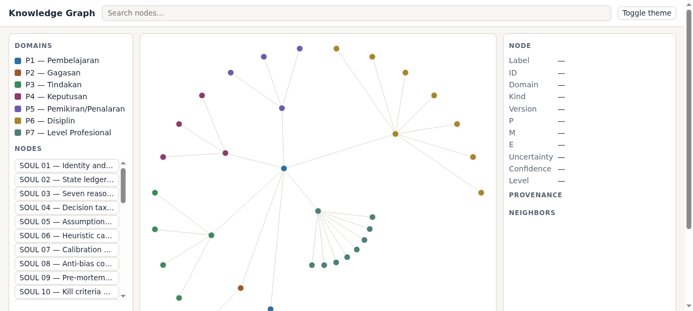
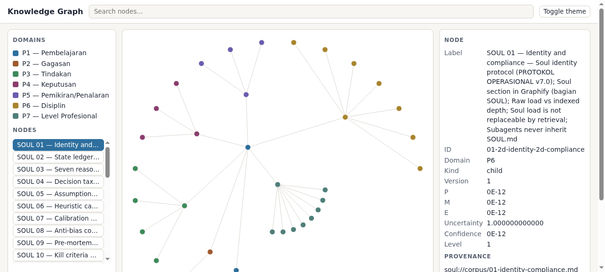
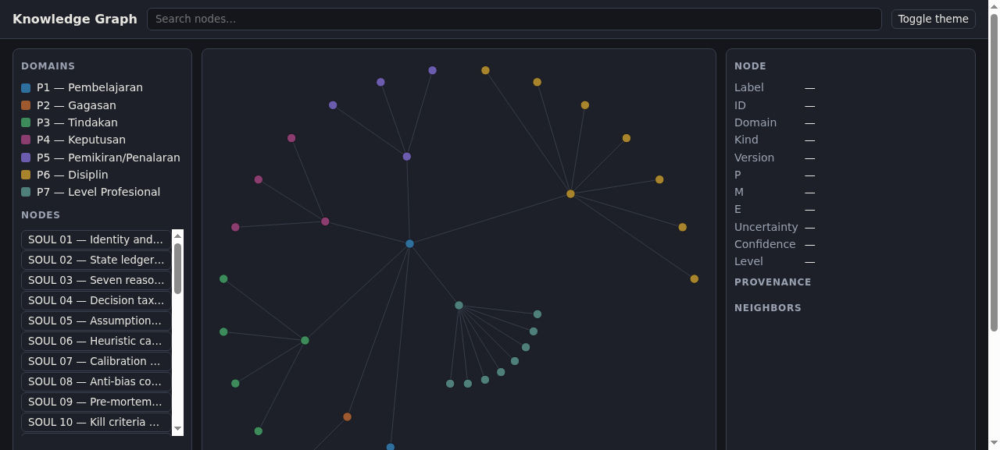
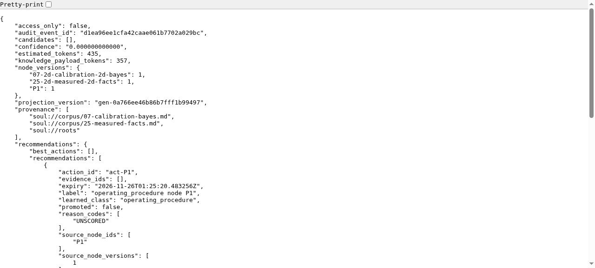

<div align="center">

[🇬🇧 English](README.md) | **🇮🇩 Bahasa Indonesia**

</div>

# Know Your Soul

[](https://github.com/Sigit-AP/know-your-soul/actions/workflows/ci.yml)
[](https://pypi.org/project/know-your-soul/)
[](https://www.python.org/)
[](LICENSE)

**Layanan memori untuk agent.** Ia menyimpan apa yang dipelajari agent dalam
satu graph lokal yang teraudit — dinilai, berversi, dan mustahil berubah tanpa
persetujuanmu. Tidak ada model, embedding, atau panggilan provider di dalamnya.
AI tetap di sisi agent; ini bagian yang tidak pernah menebak.

> Agent membaca ulang dokumen yang sama di setiap sesi dan membayar harga token
> penuh untuk itu. Know Your Soul menjawab dari graph: **hemat token 94,2%**,
> setiap jawaban membawa provenance dan id audit-nya.

## Instalasi

**Butuh:** Python 3.14

```bash
pip install know-your-soul
```

Dari source:

```bash
git clone https://github.com/Sigit-AP/know-your-soul.git
cd know-your-soul
uv sync --frozen
```

## Pemakaian

```bash
know-your-soul --store demo.sqlite3 log-event \
  '{"node_id":"n1","parent_id":"p1-root","domain":"P1",
    "summary":"Selalu verifikasi sebelum mengklaim selesai",
    "provenance":["soul://demo"],"source_version_id":"demo-v1"}'

know-your-soul --store demo.sqlite3 rebuild
know-your-soul --store demo.sqlite3 query \
  '{"purpose":"verify before claiming done","token_budget":400}'

know-your-soul export --format all        # graph.html + DOT/Mermaid/CSV/GraphML/SVG + buku
know-your-soul analytics --modules all    # centrality, communities, cycles, health, timeline
know-your-soul serve --socket demo.sock   # API lokal persisten
know-your-soul diagnose                   # self-check menyeluruh, exit code mencerminkan kesehatan
```

Hermes mendaftarkannya sebagai MCP server; setup:
[docs/integration/hermes.md](docs/integration/hermes.md).

## Apa yang kamu dapatkan

**Graph viewer** — `export` menulis `graph.html` mandiri. Tanpa CDN, tanpa
dependensi JavaScript, jalan offline. Ini hasil nyata dari sistem yang berjalan
di korpus benchmark:

<p align="center">
  
</p>

Klik sebuah node, dapatkan skor dan provenance-nya:

<p align="center">
  
</p>

<p align="center">
  
</p>

**Jawaban dengan bukti** — setiap panggilan, termasuk bacaan, tercatat sebagai
satu event dalam store SQLite append-only berantai-hash. Respons query langsung
membawa id audit-nya:

<p align="center">
  
</p>

**Belajar dengan kontrak** — node membawa skor P/M/E di bawah matematika beku.
Perbaikan datang sebagai proposal diff yang kamu setujui; rollback byte-exact.
Perubahan korpus menghasilkan relearn offer dan menunggumu.

**Analitik graph** — PageRank, HITS, Katz, communities, Louvain, cycles,
bridges, health check. Deterministik: input sama, byte sama, setiap run.

**Dua belas format ekspor** — DOT, Mermaid, CSV, GraphML, GEXF, Cytoscape, D3,
SVG, TGF, adjacency, plus buku markdown per domain.

## Benchmark

Korpus terkunci (28 file, 13.151 token), 24 pertanyaan beku, tanpa model:

| Metrik | Hasil |
|---|---|
| Kasus diterima | 24/24 |
| Rata-rata hemat token vs korpus mentah | 94,2% |
| Median latensi query (p50) | 7,9 ms |

Benchmark memori pada dataset LOCOMO asli (5.882 turn, 1.982 pertanyaan):

| Metrik | Hasil |
|---|---|
| recall@10 (produk, apa adanya) | 0,5433 |

Jalankan sendiri keduanya: `uv run python bench/run.py run` dan
`uv run python bench/memory/run.py run`. Bukti:
[docs/verification.md](docs/verification.md).

## Empat belas operasi

Sama di CLI, HTTP, dan MCP:

| | | | |
|---|---|---|---|
| `query` | `get_node` | `get_subtree` | `log_event` |
| `record_outcome` | `evaluate` | `review` | `propose_improvement` |
| `apply_improvement` | `rollback` | `path` | `explain` |
| `affected` | `god_nodes` | | |

## Keamanan

Batas no-AI ditegakkan saat runtime: paket provider dan vector gagal-tertutup,
socket keluar ditolak, dan MCP server menolak start bila menemukan kredensial
provider di environment-nya. Host allowlist di setiap request, perbandingan API
key dalam waktu konstan, body dibatasi, secret teredaksi, path terkurung.

## Development

```bash
uv sync --frozen
uv run pytest -q                 # 3.165 test
uv run pyright
uv run ruff check
uv run python bench/run.py run   # 24/24 diterima
```

CI menjalankan gate yang sama di Ubuntu dan macOS, plus bandit, pip-audit, dan
penjaga atribusi lisensi.

<details>
<summary>Kontribusi</summary>

Issue dan pull request diterima. Jalankan seluruh gate dulu. Jangan pernah
menambah dependensi model atau provider — penjaga runtime gagal-tertutup.
Perubahan perilaku kontrak beku hanya lewat versi kontrak baru.

</details>

## Lisensi

[Apache 2.0](LICENSE). Format proyeksi graph dikonsumsi lewat paket `graphifyy`
yang ter-pin. Atribusi di [NOTICE](NOTICE).
